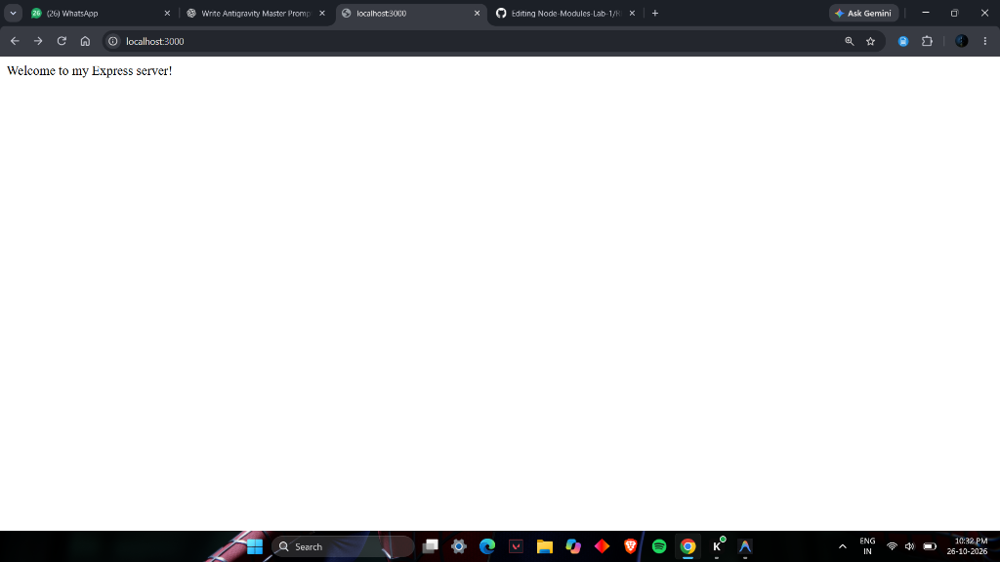
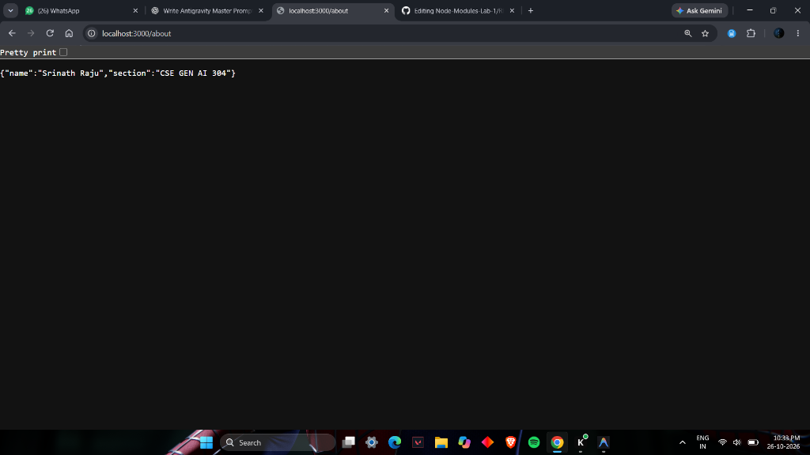
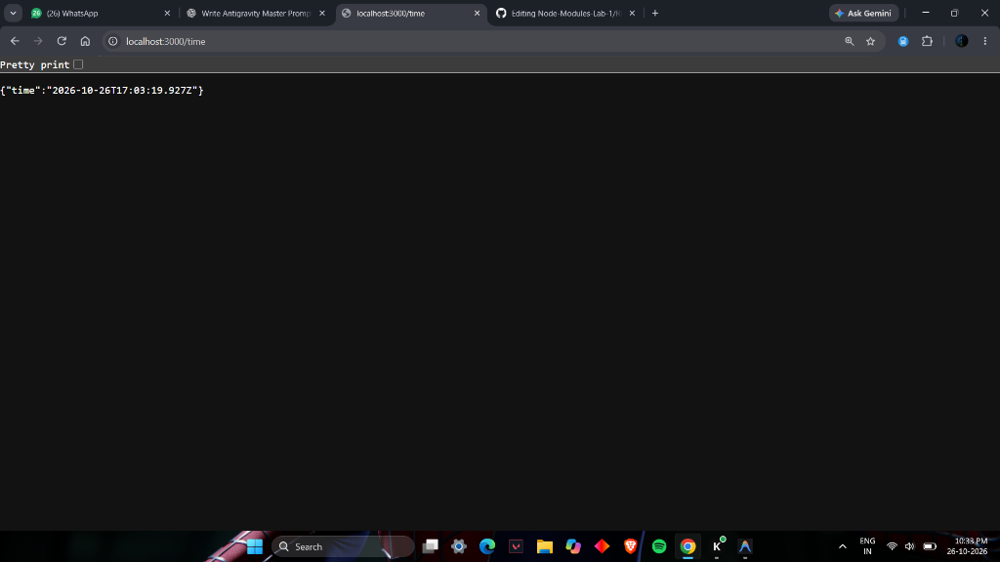
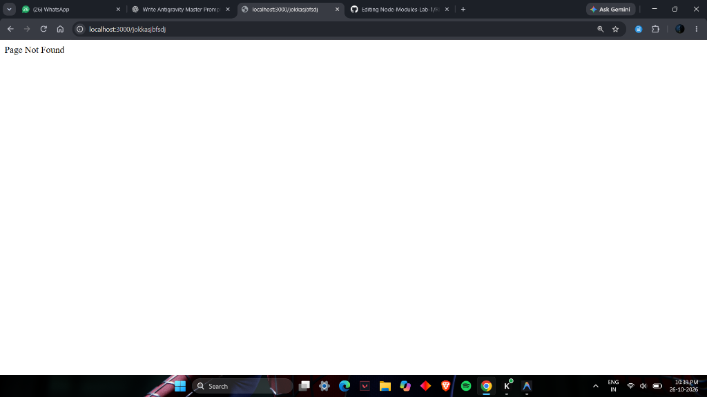

# Node-Modules-Lab-1

Node.js and Express fundamentals lab exercises.

## Repository Structure

```
NODE LAB 1.1/
├── lab-01/
│   ├── index.js          # Core HTTP module demo
│   ├── server.js         # Express server with route handling
│   ├── package.json      # Dependencies and metadata
│   └── package-lock.json # Dependency lockfile
└── screenshots/
    ├── 01-home-route.png
    ├── 02-about-route.png
    ├── 03-time-route.png
    └── 04-404-not-found.png
```

## Getting Started

1. Navigate to the lab folder:
   ```bash
   cd lab-01
   ```

2. Install dependencies:
   ```bash
   npm install
   ```

3. Run the servers:
   - **Native HTTP server** (`index.js`):
     ```bash
     node index.js
     ```
   - **Express server** (`server.js`):
     ```bash
     node server.js
     ```

## Express Server Endpoints & Output Screenshots

The server runs on `http://localhost:3000`.

### 1. Home Route (`GET /`)
Returns a welcome message:
> `Welcome to my Express server!`



---

### 2. About Route (`GET /about`)
Returns student and course section information in JSON format:
```json
{
  "name": "Srinath Raju",
  "section": "CSE GEN AI 304"
}
```



---

### 3. Time Route (`GET /time`)
Returns current server timestamp in ISO format:



---

### 4. 404 Not Found (Fallback Route)
Handles any undefined route with status code `404`:
> `Page Not Found`


