# Lab 3: REST API, query parameters, validation, debugging

- **Name:** Srinath Raju
- **Registration Number:** 252U1R9018
- **Section:** CSE GEN AI - 2A , 304
- **Course:** Backend Development Fundamentals · Year II Term II · Aurora · Faculty: Joel Prashanth D
- **Lab Number:** 03

## Live Link

- **Deployment URL:** https://backend-lab-reports-4.onrender.com

*(Hosted on Render's free tier. The first request after a period of inactivity can take up to a minute while the server wakes up. Data resets on restart and is re-seeded automatically.)*

## How to run

Requirements: Node.js 18 or newer.

```bash
cd lab-03
npm install
cp .env.example .env        # Windows: copy .env.example .env
npm run seed                # optional: loads 25 sample books (also happens on start when the table is empty)
npm start                   # server on http://localhost:3000
```

Other commands: `npm run dev` (auto-restart on changes) and `npm test` (56 automated tests, uses an in-memory database).

**Environment variables** (see `.env.example`; the real `.env` is never committed):

| Variable | Meaning | Example |
| --- | --- | --- |
| `PORT` | Port the server listens on | `3000` |
| `DB_PATH` | SQLite database file (created automatically) | `./data/books.db` |
| `AUTO_SEED` | Insert sample books on start when the table is empty | `true` |

**Deploying (Render / Railway):** build command `npm install`, start command `npm start`; the platform sets `PORT` itself. Add `AUTO_SEED=true` so the free instance (whose disk is reset on restart) always has sample data.

## Endpoints

Endpoints are nouns (`/books`); the HTTP method says what to do.

| Method | Path | Description | Success | Failure |
| --- | --- | --- | --- | --- |
| GET | `/books` | List books with search, sort, price filter and pagination | 200 | 400 bad query |
| GET | `/books/:id` | Get one book | 200 | 400 bad id, 404 not found |
| POST | `/books` | Create a book (title, author, price) | 201 | 400 validation |
| PUT | `/books/:id` | Replace title, author and price of a book | 200 | 400 validation / bad id, 404 not found |
| DELETE | `/books/:id` | Delete a book | 200 | 400 bad id, 404 not found |
| GET | `/health` | Health check | 200 | |
| GET | `/` | API information | 200 | |

### Query parameters for `GET /books`

| Parameter | Meaning | Default | Rules |
| --- | --- | --- | --- |
| `search_q` | Partial, case-insensitive title match (`LIKE`) | none (no filter) | `%` and `_` are searched literally |
| `order_by` | Column to sort by | `id` | `id`, `title`, `author` or `price` (whitelist) |
| `order` | Sort direction | `ASC` | `ASC` or `DESC` (any case) |
| `limit` | Rows per page | `10` | integer 1 to 100 |
| `offset` | Rows to skip | `0` | integer >= 0 |
| `min_price` | Lowest price | none | number >= 0 |
| `max_price` | Highest price | none | number >= 0, not less than `min_price` |

When both prices are given the query uses `price BETWEEN ? AND ?`; with only one it uses `>=` or `<=`.
Example: `/books?search_q=sql&min_price=500&max_price=800&order_by=price&order=DESC&limit=5&offset=0`

### Request body for `POST` and `PUT`

```json
{ "title": "Clean Code", "author": "Robert C. Martin", "price": 799 }
```

`title` and `author` must be non-empty strings (max 200 characters); `price` must be a number >= 0 (a numeric string such as `"499"` is accepted). A missing field or a non-numeric price gives `400`.

### Response format

Every response is JSON in one consistent shape.

```jsonc
// success
{ "message": "Book created successfully", "data": { "id": 26, "title": "...", "author": "...", "price": 499 } }
// list (also has pagination)
{ "message": "Books fetched successfully", "data": [ ... ], "pagination": { "total": 25, "count": 10, "limit": 10, "offset": 0 } }
// every error
{ "message": "Validation failed: price must be a number" }
```

| Status | When |
| --- | --- |
| 200 OK | Read, update and delete succeeded |
| 201 Created | Book created (also sends a `Location: /books/:id` header) |
| 400 Bad Request | Invalid body, invalid query parameter, invalid id, malformed JSON |
| 404 Not Found | Valid id but no such book, or unknown route |
| 500 Internal Server Error | Unexpected server problem (details only in the server log) |

## Screenshots

### Server Startup, Database and Automated Tests

#### 1. Server Start
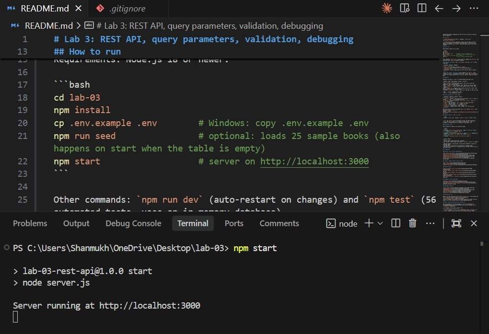
*Running `npm start` initiates `server.js`, loads `.env` configuration, establishes the SQLite database connection, checks port availability, and starts listening on `http://localhost:3000`.*

#### 2. SQLite Database View
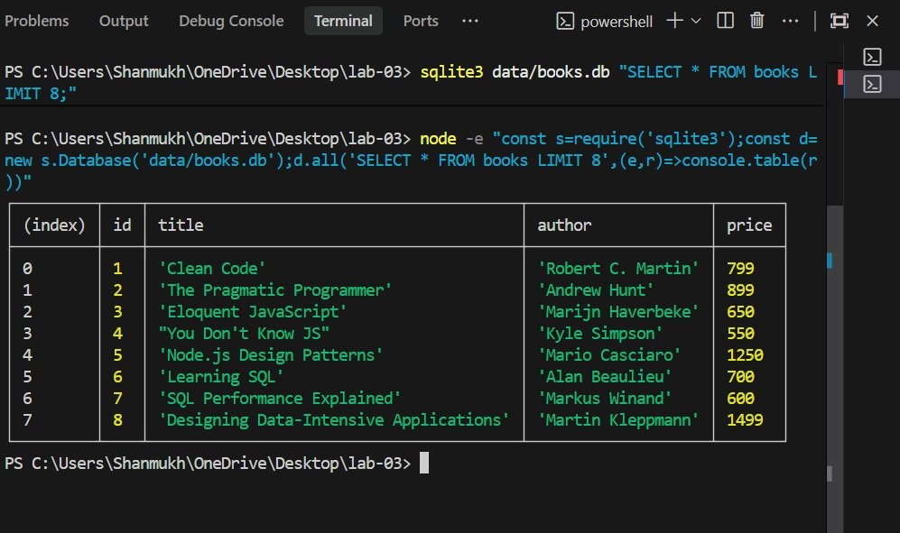
*Inspecting the `books` table in the SQLite database (`data/books.db`) via the Node CLI, confirming that sample records are seeded with `id`, `title`, `author`, and `price`.*

#### 3. Automated Test Suite (56 Passing)
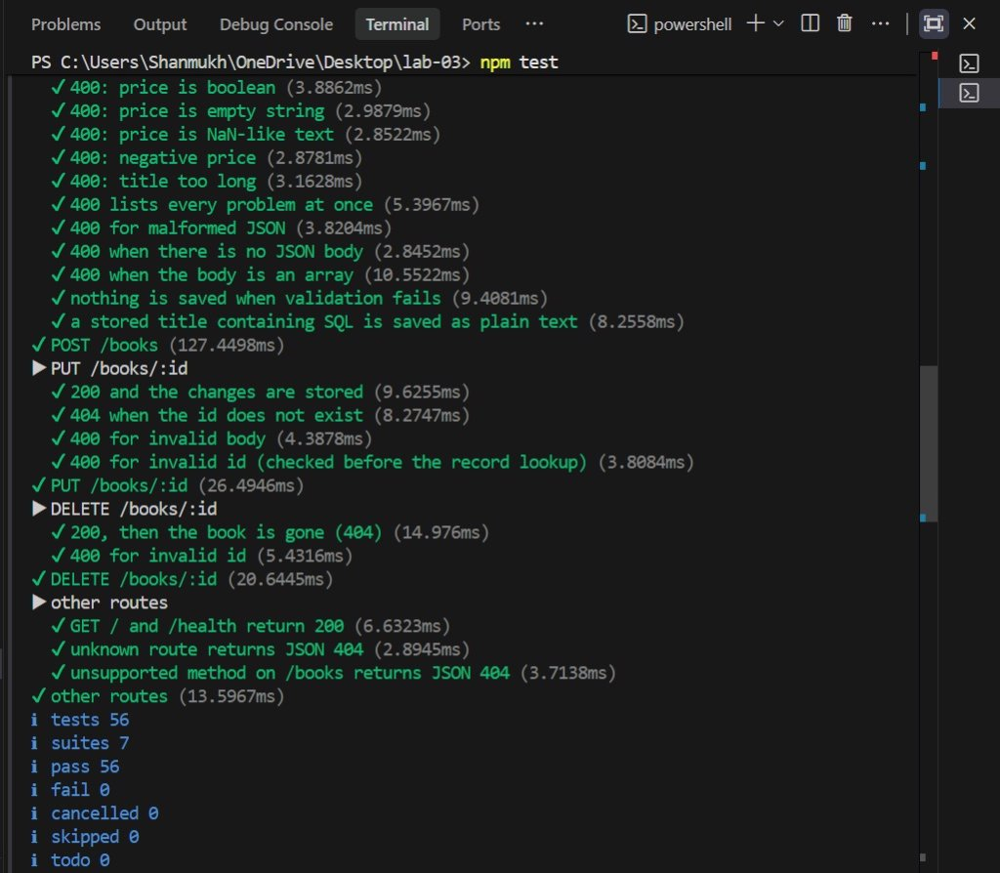
*Executing `npm test` runs Node's built-in test runner across 7 test suites, verifying all 56 assertions (query parameters, validation, CRUD endpoints, edge cases) with 0 failures.*

#### 4. Postman Collection Runner (91 Assertions Passed)
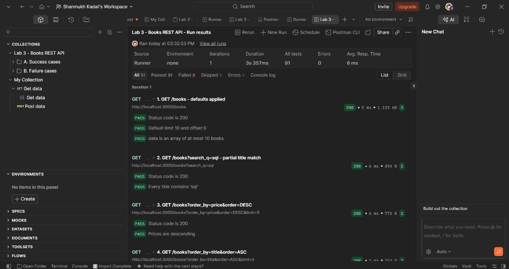
*Automated execution of the complete `Lab 3 - Books REST API` collection in Postman: all 34 requests (12 success cases and 22 failure cases) passed all 91 assertions with 0 errors.*

---

### Live Deployment

#### Live Service Health Check
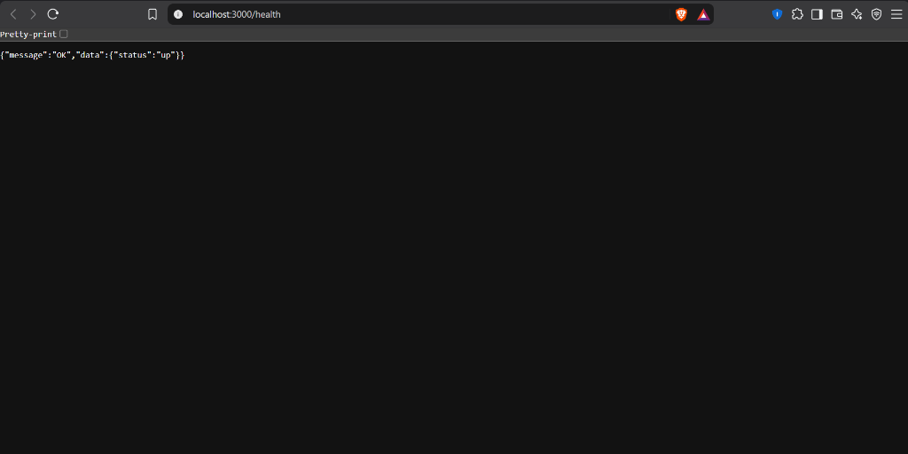
*Live deployment on Render: navigating to `/health` in the browser returns `200 OK` with `{"message":"OK","data":{"status":"up"}}`.*

---

### Search, Sort, Filters and Pagination

#### 5. GET /books (Default Values)
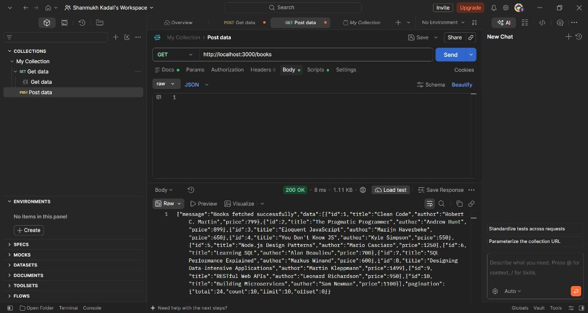
*Standard `GET /books` request without query parameters. Returns the default first page with `limit=10`, `offset=0`, sorted by `id ASC`, along with pagination metadata (`total`, `count`).*

#### 5b. GET /books/1 (Fetch Book by ID)
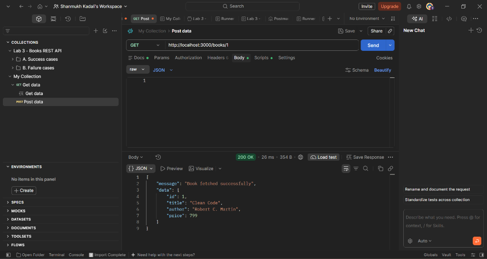
*`GET /books/1` retrieves a single book by its primary key ID, returning `200 OK` with full book details ("Clean Code").*

#### 6. Title Search (`search_q`)

*`GET /books?search_q=sql` performs a case-insensitive, parameterized SQL `LIKE` search on the `title` column, returning only books matching "sql" ("Learning SQL" and "SQL Performance Explained").*

#### 7. Sorting by Price Descending
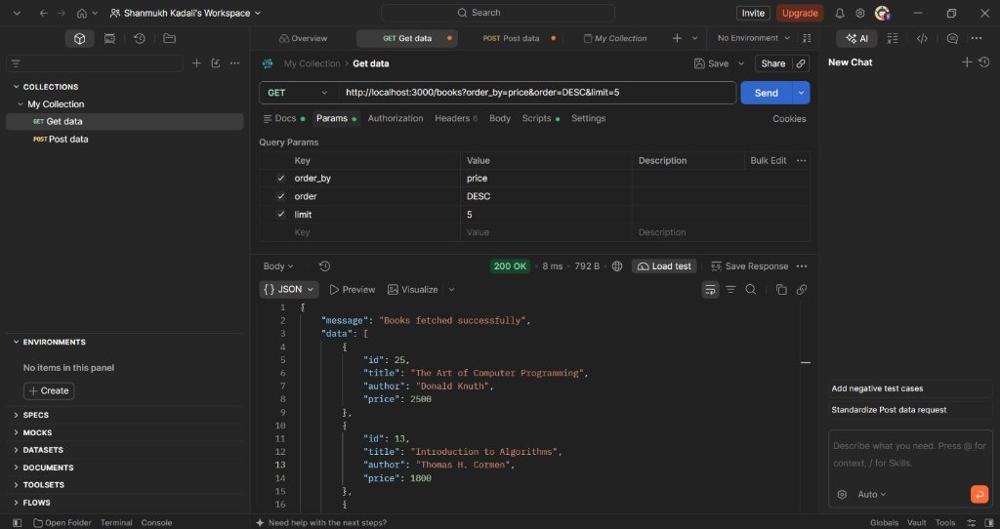
*`GET /books?order_by=price&order=DESC&limit=5` sorts books by `price` in descending order against a whitelist-checked column name, returning the highest-priced books first.*

#### 8. Pagination with Limit and Offset
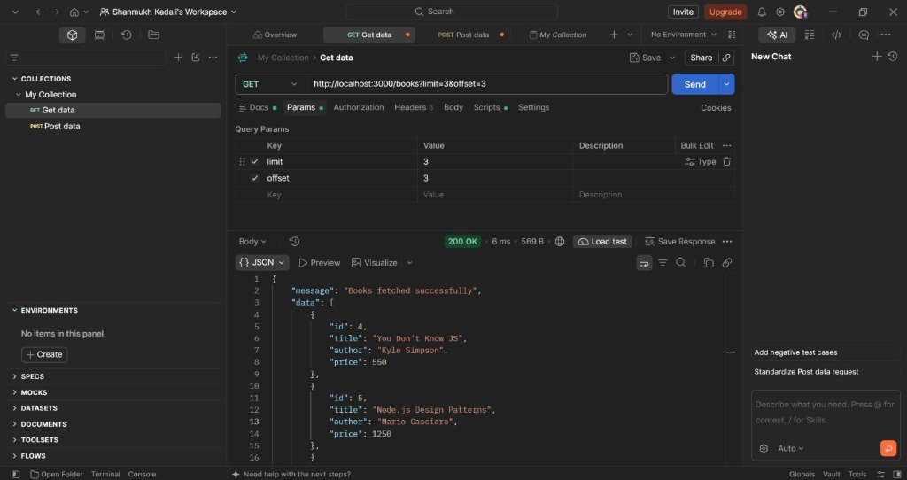
*`GET /books?limit=3&offset=3` skips the first 3 records (`offset=3`) and retrieves the subsequent 3 books (`limit=3`), returning records with IDs 4, 5, and 6.*

#### 9. Price Range Filter (`min_price` and `max_price`)
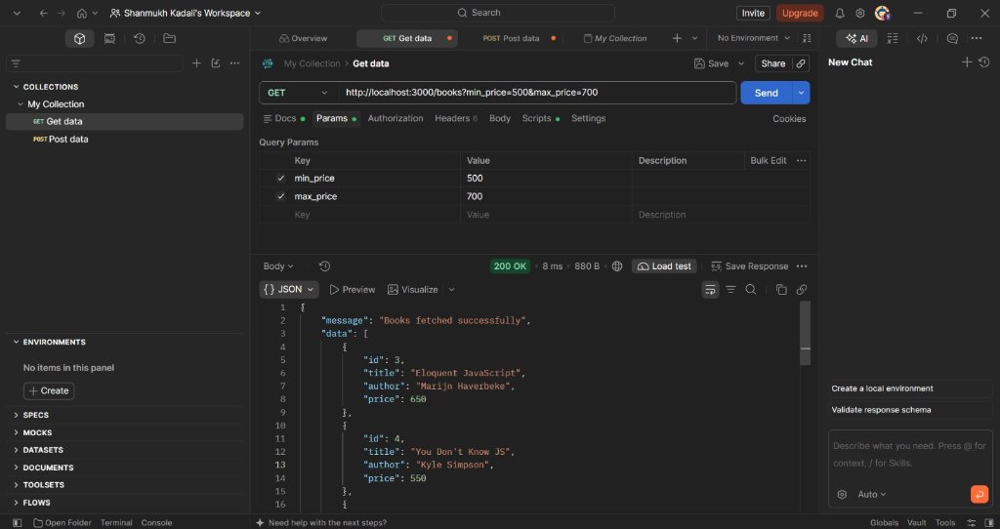
*`GET /books?min_price=500&max_price=700` applies a parameterized SQL `BETWEEN ? AND ?` clause to retrieve books whose price falls strictly between 500 and 700.*

#### 10. Combined Search, Filter and Sort
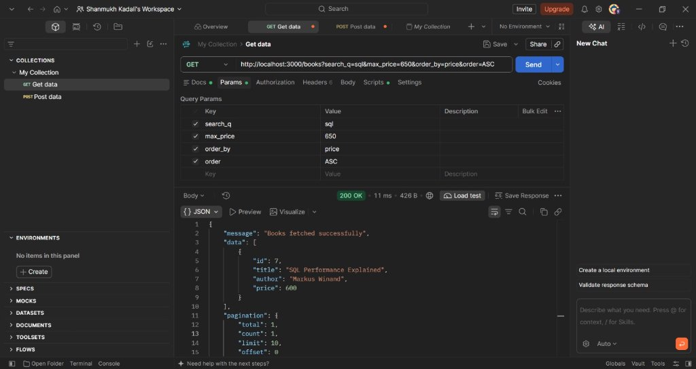
*`GET /books?search_q=sql&max_price=650&order_by=price&order=ASC` demonstrates multiple query parameters composed together safely in SQL: searching "sql", capping price at 650, and sorting by price ascending.*

---

### Create, Update, Delete (Success Cases)

#### 11. POST /books (201 Created)
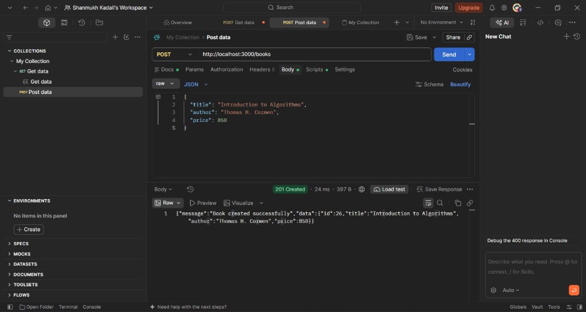
*`POST /books` with a valid JSON payload (`title`, `author`, `price`) inserts the new book into SQLite and returns `201 Created` with the newly assigned `id` and a `Location: /books/:id` header.*

#### 12. PUT /books/:id (200 OK)
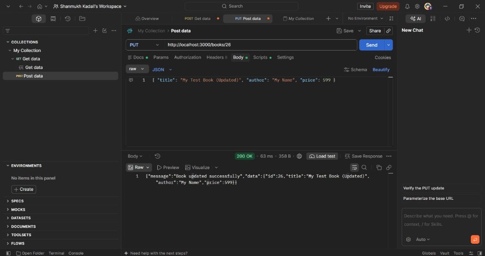
*`PUT /books/26` replaces all editable fields (`title`, `author`, `price`) of an existing book, verifying changes are persisted and returning `200 OK` with the updated book record.*

#### 13. DELETE /books/:id (200 OK, then 404)
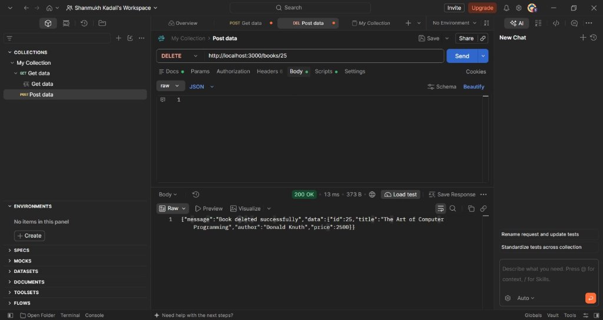
*`DELETE /books/25` removes the book with ID 25 and returns `200 OK` with the deleted row data.*

#### 13b. DELETE /books/:id Already Deleted (404 Not Found)
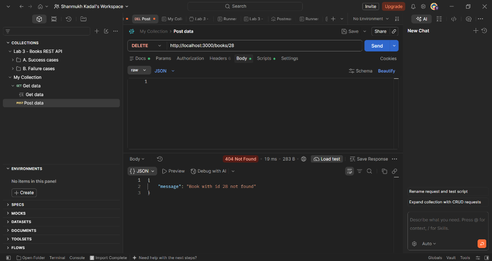
*Attempting to delete a book ID that has already been deleted (e.g. ID 28) returns `404 Not Found` with `{"message": "Book with id 28 not found"}`.*

---

### Input Validation & Failure Cases

#### 14. POST Validation Errors (400 Bad Request)
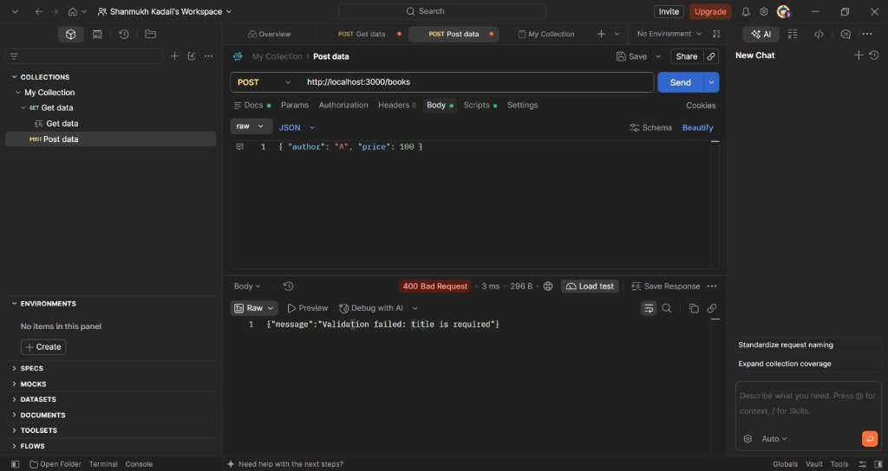
*Sending a `POST /books` request missing the required `title` field fails validation in `middleware/validate.js`, returning `400 Bad Request` with an informative error message: `{"message": "Validation failed: title is required"}`.*

#### 15. Invalid ID (400 Bad Request) & Missing Record (404 Not Found)
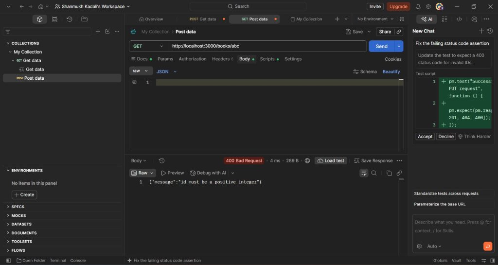
*`GET /books/abc` fails ID format validation before hitting the database, returning `400 Bad Request` (`"id must be a positive integer"`). Meanwhile, `GET /books/99999` with a syntactically valid ID that does not exist returns `404 Not Found`.*

#### 16. Invalid Query Parameters (400 Bad Request)
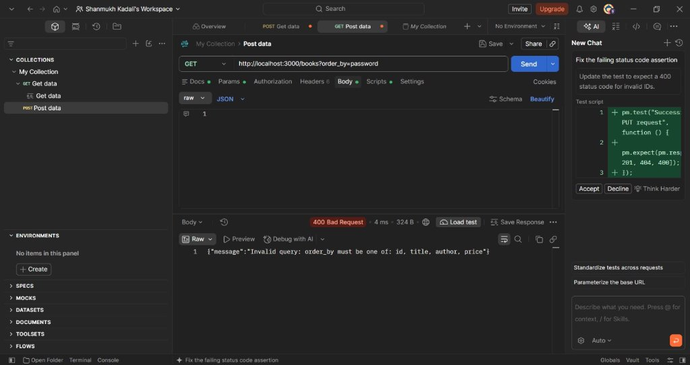
*`GET /books?order_by=password` checks the sort column against the whitelist (`id`, `title`, `author`, `price`) and immediately rejects unauthorized columns with `400 Bad Request`.*

#### 17. Malformed JSON Body & Unknown Route (400 / 404)
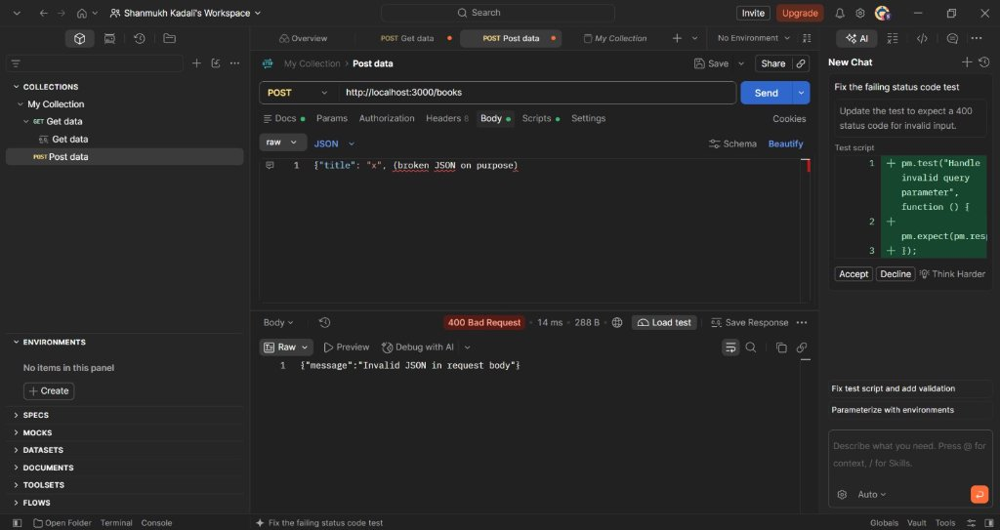
*Sending malformed JSON syntax in the request body is caught by Express's JSON error-handling middleware, returning `400 Bad Request` (`"Invalid JSON in request body"`), while accessing unregistered routes like `GET /authors` returns a consistent JSON `404 Not Found`.*

#### 18. SQL Injection Immunity
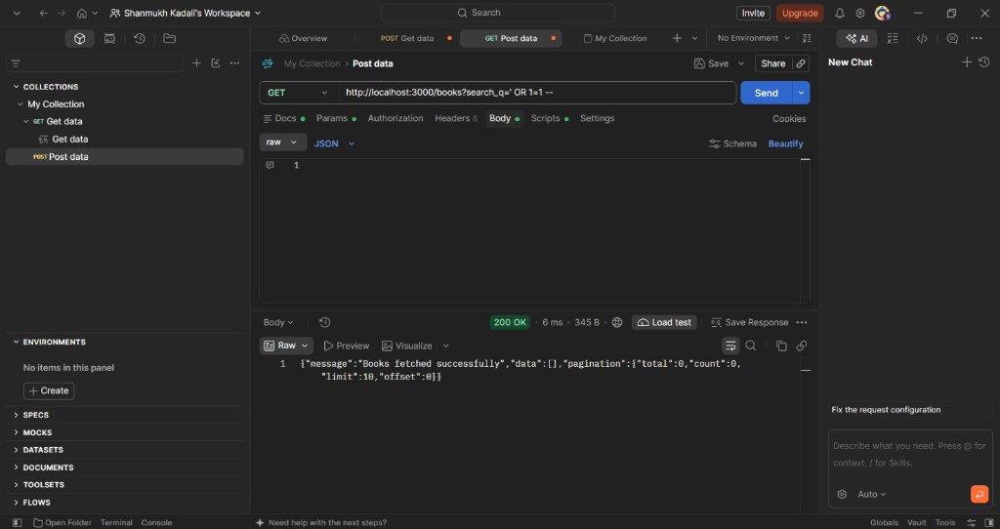
*Sending malicious SQL injection strings such as `search_q=' OR 1=1 --` safely evaluates as literal search text via parameterized queries (`?`), returning 0 results instead of executing unauthorized database commands.*

---

### Debugging Exercise

#### 19. Bug 1: Wrong Import Path
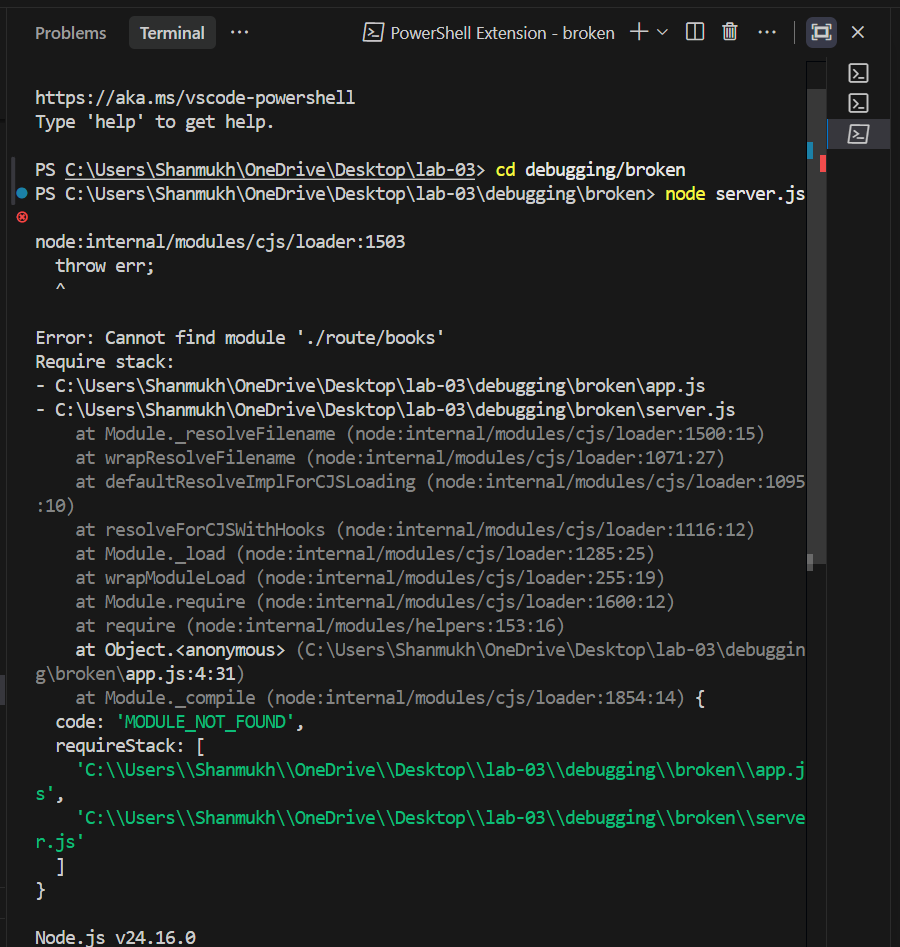
*`node server.js` in `debugging/broken` crashes on startup with `Error: Cannot find module './route/books'` due to an incorrect singular directory name in `app.js`.*

#### 20. Bug 1 Fixed: Correct Import Path
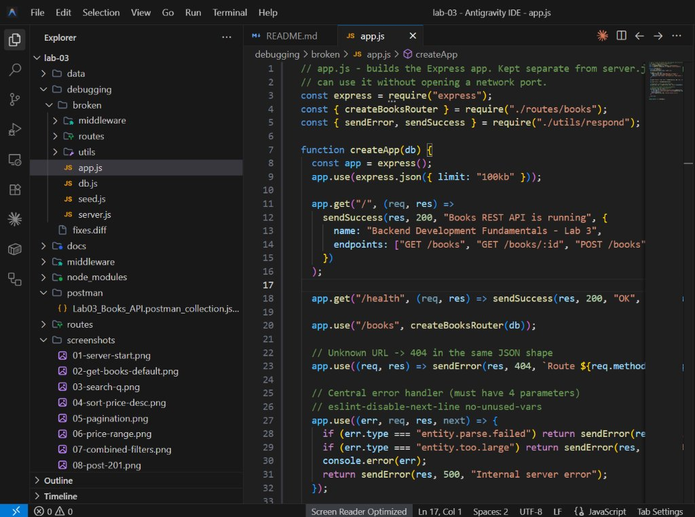
*Correcting line 4 in `debugging/broken/app.js` to `require("./routes/books")` resolves the module path resolution error.*

#### 21. Bug 2: Port Conflict (EADDRINUSE)
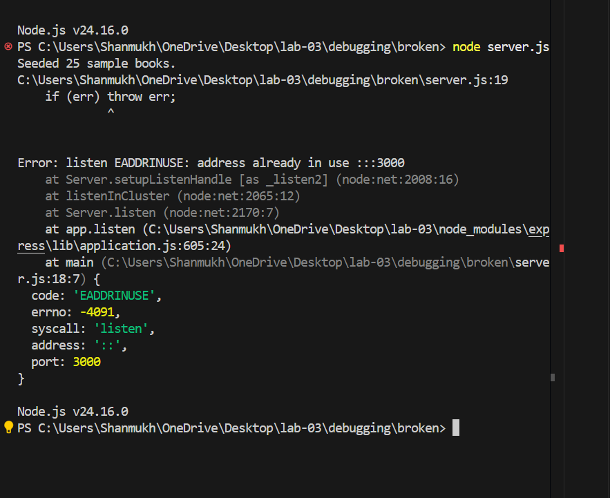
*Attempting to launch a second instance of the server on the same port crashes with `Error: listen EADDRINUSE: address already in use :::3000`, illustrating why single-port ownership is required.*

#### 22. Bug 3: SQL Table Name Typo
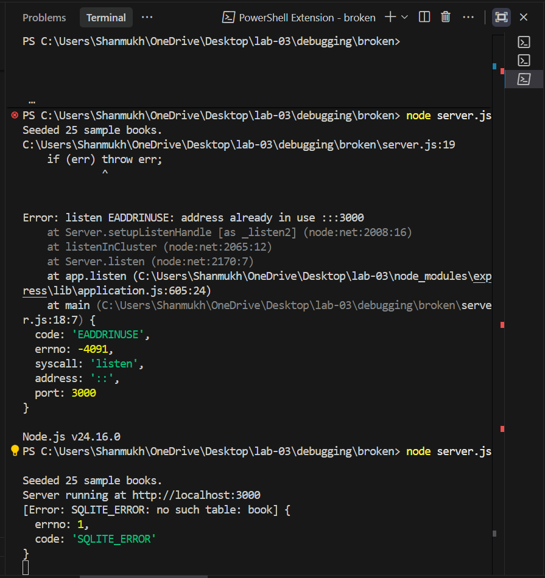
*`GET /books` returns `500 Internal Server Error`, and the server log reveals `[Error: SQLITE_ERROR: no such table: book]` caused by writing `FROM book` instead of `FROM books` in the SQL query.*

#### 23. Bug 4: Missing `await` in Database Query
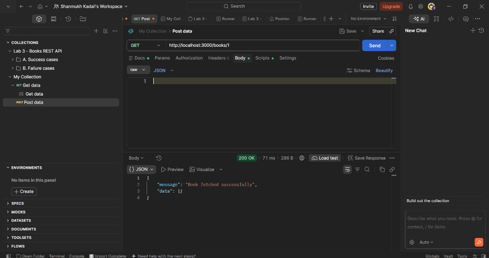
*`GET /books/1` returns `200 OK` with `"data": {}` because `db.get()` returns a Promise object. Without `await`, the unresolved Promise is serialized to empty JSON `{}`.*

#### 24. All Bugs Fixed
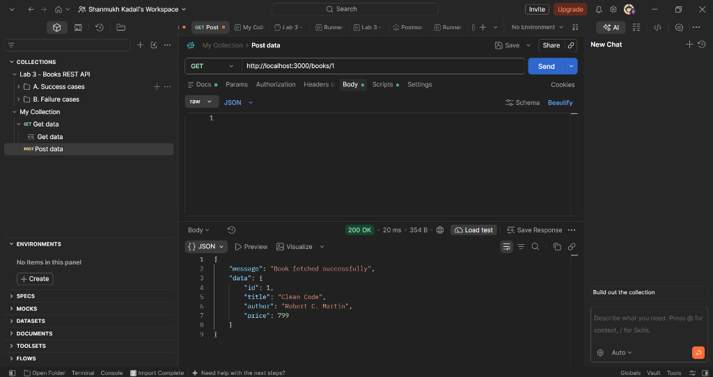
*Adding `await` to `db.get(...)` on line 62 in `routes/books.js` resolves the asynchronous resolution bug, properly returning the complete book object.*

## Postman test list

Import `postman/Lab03_Books_API.postman_collection.json` into Postman and run it with the Collection Runner (server running on `http://localhost:3000`, sample data loaded).
It has 34 requests (12 success, 22 failure) with test scripts; the full table is in [`docs/POSTMAN_TESTS.md`](docs/POSTMAN_TESTS.md).

## Notes: problems faced and how I solved them

The full write-up with error messages is in [`docs/DEBUGGING.md`](docs/DEBUGGING.md). The broken project and the exact changes are in [`debugging/`](debugging/).

| # | Problem | Error seen | Cause | Fix |
| --- | --- | --- | --- | --- |
| 1 | Port conflict | `Error: listen EADDRINUSE: address already in use :::3000` | Another copy of the server was already using port 3000 | Stopped the old process (or used another `PORT`); `server.js` now prints a clear message |
| 2 | Wrong import path | `Error: Cannot find module './route/books'` | The folder is `routes`, not `route` | `require("./routes/books")` |
| 3 | Table-name typo | `SQLITE_ERROR: no such table: book` (500 response) | Query used `book`; the table is `books` | Corrected the table name in the SQL |
| 4 | Missing `await` | `200 OK` with `"data": {}`; 404 never returned | `db.get()` returns a Promise; without `await` the route used the Promise | Added `await` before `db.get(...)` |

Other things I learned while building it:

- **Whitelist for `order_by`.** A `?` placeholder can hold a value but not a column name, so `order_by` and `order` are checked against a fixed list before being placed in the SQL. All values (search text, prices, limit, offset, id) use `?` parameters.
- **`LIKE` wildcards.** `%` and `_` typed by the user are escaped (`ESCAPE '\'`), so `search_q=50%` searches for the literal text.
- **Sorting text.** SQLite sorts upper case before lower case by default, so `title` and `author` use `COLLATE NOCASE` to give a real A-Z order.
- **Stable pages.** Results are ordered by the chosen column, then by `id`, so rows never move between pages.
- **400 vs 404.** An id such as `abc` is bad input (400); a valid id that is not in the table is a missing record (404). The id format is checked before the database is touched.
- **Port conflicts on Express 5.** Express 5 passes a listen error to the callback instead of crashing, so `server.js` checks it there (and on the `error` event for Express 4).

## Project structure

```text
lab-03/
├── server.js              # start-up: .env, database, listen, port-conflict handling
├── app.js                 # Express app, JSON 404 and error handler
├── db.js                  # SQLite connection and table creation
├── seed.js                # sample data (npm run seed)
├── routes/books.js        # the /books endpoints
├── middleware/validate.js # body, id and query validation
├── utils/respond.js       # consistent response helpers
├── tests/books.test.js    # 56 automated tests
├── postman/               # Postman collection
├── docs/                  # Postman test list, debugging notes, viva answers
├── debugging/             # broken project + fixes.diff
├── screenshots/
├── .env.example
└── .gitignore
```

Viva preparation: [`docs/VIVA.md`](docs/VIVA.md).
