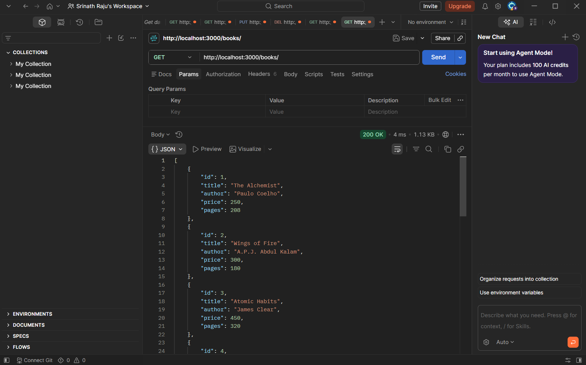
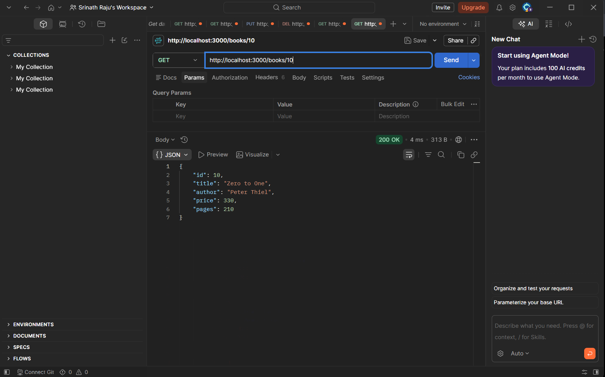
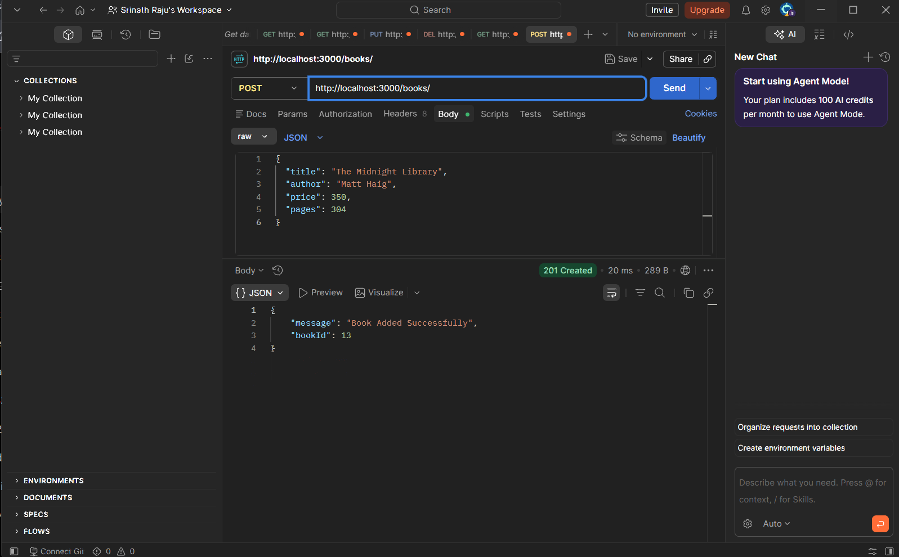
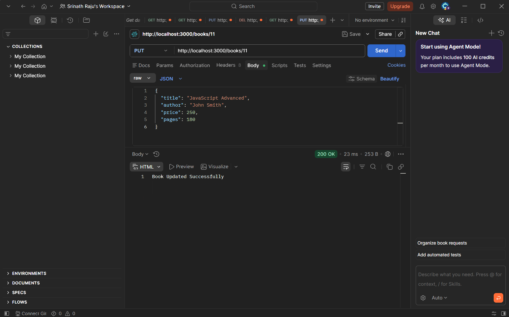
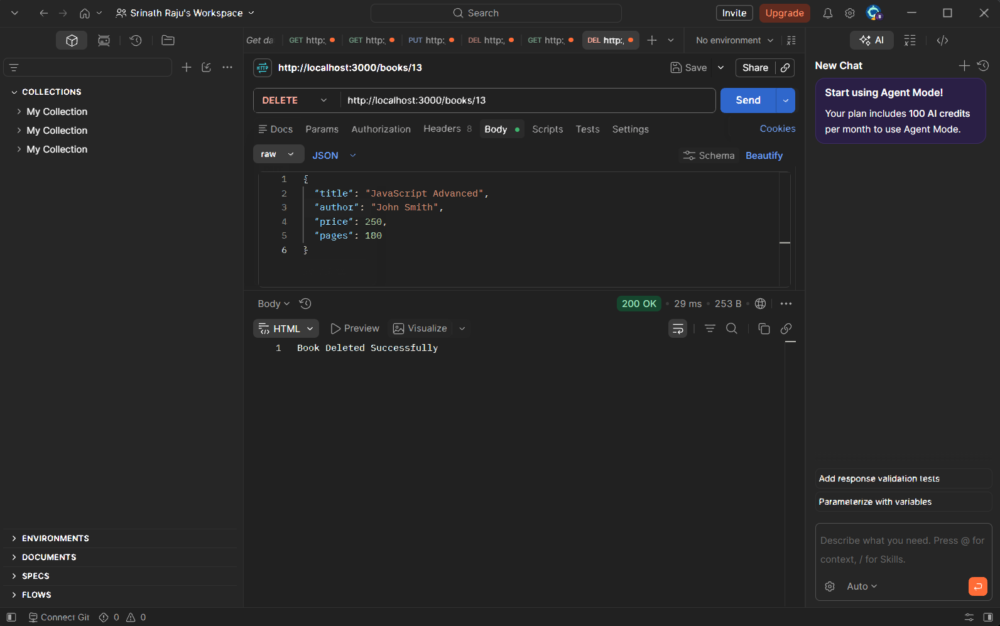

# Node Lab 2 — SQLite CRUD API

## Objective
Create a Node.js and Express API connected to an SQLite database.

## Technologies
- Node.js
- Express
- SQLite
- Postman
- Nodemon

## Project Files
- server.js — API routes
- init-db.js — Database initialization
- database.sql — SQL statements
- books.db — SQLite database
- package.json — Dependencies and scripts

## Setup
Install dependencies:

    npm install

Initialize the database:

    node init-db.js

Start the server:

    npm run dev

Server address: http://localhost:3000

## API Endpoints

| Method | Endpoint | Purpose |
|---|---|---|
| GET | /books/ | Get all books |
| GET | /books/:bookId/ | Get one book |
| POST | /books/ | Add a book |
| PUT | /books/:bookId/ | Update a book |
| DELETE | /books/:bookId/ | Delete a book |

## Testing

### GET — All Books

### GET — Single Book

### POST — Add Book

### PUT — Update Book

### DELETE — Delete Book

## Deployment
Live URL: [https://lab2bdf.onrender.com](https://lab2bdf.onrender.com)

## Student Details
- Name: Srinath Raju
- Registration Number: 252U1R9018
- Section: CSE GEN AI 304